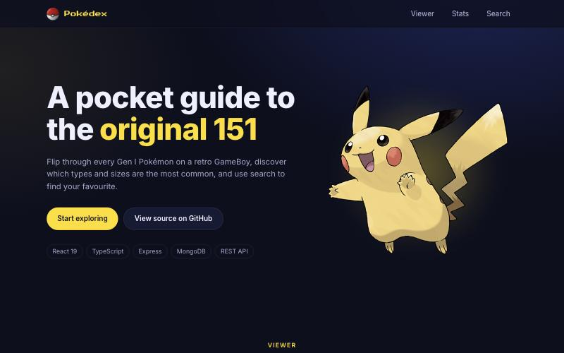
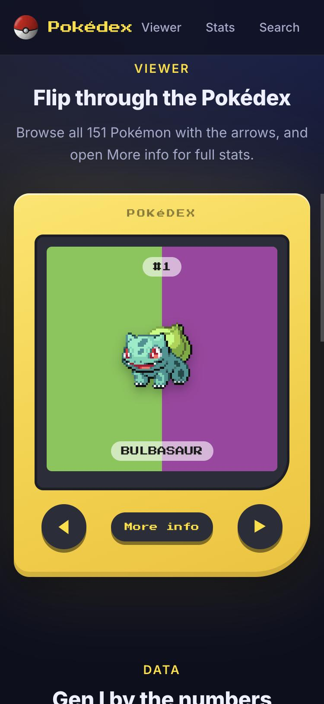
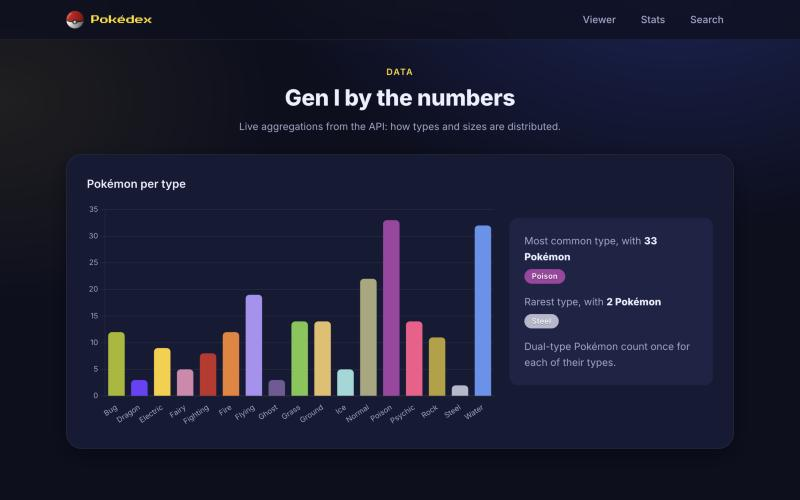

# Pokédex: a pocket guide to the original 151

[](https://github.com/panu-kangas/pokedex_app/actions/workflows/ci.yml)


A full-stack Pokédex for the first 151 Pokémon: flip through them on a retro GameBoy, explore type and size statistics, and search by name. Built as a portfolio project with a typed React frontend, a layered Express API and MongoDB.

**🔗 Live: [pokedex-app-seven-tan.vercel.app](https://pokedex-app-seven-tan.vercel.app)**

<p>
  
  
</p>


## Highlights

- **TypeScript end to end.** An npm workspaces monorepo where the frontend and the API share one set of types (`packages/shared`).
- **Layered REST API.** Express 5 with `routes → controllers → services → models`, request validation with zod, central error handling, and MongoDB aggregation pipelines for the statistics.
- **Security basics, verified.** Helmet headers, a CORS allow-list, escaped user input in search, and per-client rate limiting configured for the real proxy chain in production (Cloudflare → Render), with tests that fail on a wrong setting.
- **Tested.** Vitest throughout: API integration tests with Supertest against an in-memory MongoDB, and component tests with React Testing Library. See [docs/testing.md](docs/testing.md).
- **CI/CD.** GitHub Actions runs lint, format check, type checks, tests with coverage, the build and `npm audit` on every PR, plus CodeQL scanning and grouped Dependabot updates. Every PR gets a Vercel preview deployment; `main` deploys automatically.
- **Responsive design.** A mobile-first dark theme built on design tokens and CSS Modules.

## Tech stack

| Layer    | Tools                                                            |
| -------- | ---------------------------------------------------------------- |
| Frontend | React 19, TypeScript, Vite, CSS Modules, Chart.js, Framer Motion |
| Backend  | Node.js, Express 5, TypeScript, zod, Mongoose                    |
| Database | MongoDB Atlas, seeded from [PokéAPI](https://pokeapi.co)         |
| Testing  | Vitest, Supertest, mongodb-memory-server, Testing Library        |
| Delivery | GitHub Actions, CodeQL, Dependabot, Vercel (web), Render (API)   |

## Roadmap

Work happens in small, reviewed PRs following [PLAN.md](PLAN.md). Next up:

- Richer data: abilities, flavour text and evolution chains, with an idempotent, retrying seeder
- A versioned API with pagination, filtering and sorting
- Routing with a browsable Pokédex, detail pages and an insights page

## Local development

Requires Node.js 22+ and a MongoDB connection string.

```bash
npm install
cp apps/api/.env.example apps/api/.env   # fill in MONGO_URI
cp apps/web/.env.example apps/web/.env
npm run seed                             # first time only
npm run dev                              # API on :5000, web on :5173
```

Other scripts: `npm test`, `npm run lint`, `npm run typecheck`, `npm run build`.

---

Built by [Panu Kangas](https://github.com/panu-kangas). Pokémon data from the public [PokéAPI](https://pokeapi.co); Pokémon and Pokémon names are trademarks of Nintendo, Game Freak and Creatures. This is a non-commercial learning project.
